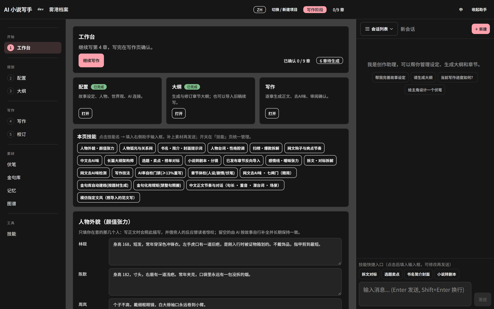
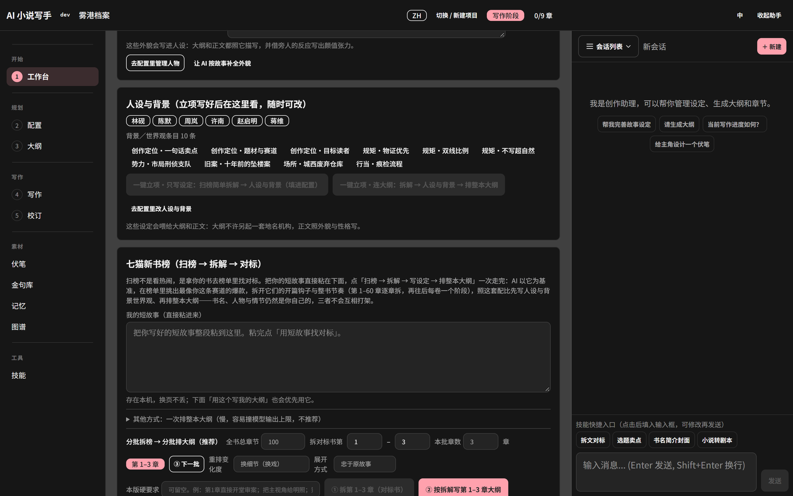
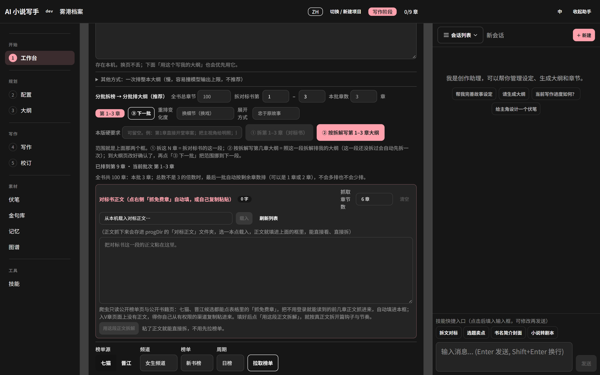

# Show Me The Story

**一个带长期记忆的 AI 长篇小说写作工作台。**
逐章生成、逐章审核，把「人设 / 世界观 / 已写正文 / 关键事实 / 未回收伏笔」一起带进每一次续写。

*A local-first workbench for long-form AI fiction: outline, draft, review, and keep the story consistent chapter after chapter.*

**网页版项目主页：** <https://leijingqiu3-ops.github.io/show-me-the-story-demo/>



## 它解决什么问题

单章生成谁都会，难的是写到一百章：人设崩了、时间线乱了、伏笔忘了、同一个桥段用了三次。
这个工具把「设定」变成可校验的数据，每写完一章就抽取事实、比对设定、追踪伏笔，让长篇能持续写下去。

## 亮点：先扫七猫 / 晋江榜，再拆真正文

大多数 AI 写作工具从一句提示词开始。这个工作台先让你看市场：
**拉真实榜单 → AI 按你的短故事选对标 → 拿对标的真正文 → 拆开篇钩子与整书节奏 → 按拆解排本批大纲。**



### 扫榜（找对标）

榜单只是候选池，不用自己挑：主按钮会让 AI 按你的短故事从里面选对标。

1. 选榜单源：七猫 / 晋江
2. 选频道：女生 / 男生
3. 选榜单：新书榜 / 热销榜 / 收藏榜 / 完结榜 / 更新榜
4. 选周期：日榜 / 月榜
5. 点「拉取榜单」

### 对标正文

三种来源：

- **抓免费章**：爬虫只读公开榜单页与公开书籍页，抓不用登录就能读的前几章。
- **自己粘贴**：把正文粘进「对标书正文」框。
- **从本机载入**：之前抓过的会存在 `对标正文/` 目录，选一本点「载入」。



> 入 V 章节页面上没有正文，需要你自己从有权限的渠道复制。工具不绕过付费墙。

填好后点「用这段正文拆解」，按真正文拆开篇钩子与节奏，比只看榜单准得多。

## 功能

| 模块 | 作用 |
|---|---|
| 工作台 | 进度总览：已确认章节、待生成、待审阅，一键继续 |
| 配置 | 故事类型、每章字数、写作风格、叙述视角；人物卡与世界观条目 |
| 大纲 | 按批生成 1–36 章大纲；先按七猫 / 晋江对标拆解，再分批排纲、重排 |
| 写作 | 逐章生成正文 → 去 AI 味 → 审核 → 确认 |
| 校订 | 章节级修订、段落级修订、人工编辑 |
| 伏笔 | 埋设与回收台账，完结前检查未回收项 |
| 金句库 | 按题材自动建档，写作时化用（禁止整句照搬） |
| 记忆 | 人物 / 世界观 / 组织 / 关系 / 事实，按相关性召回 |
| 图谱 | 实体关系图，检查人物与势力是否写串 |
| 技能 | 7 个已安装技能：AI 率门禁、章节体检、金句库、文风模仿等 |

### 已安装的 7 个技能

技能 = `skill.json`（元数据 + 生效阶段）+ `SKILL.md`（可执行规则）。当前项目安装了 7 个，其中 5 个已在 `.registry.json` 注册启用。

| 技能 | 作用 | 生效阶段 | 状态 |
|---|---|---|---|
| **AI 率自检门禁（≥13% 重写）** | 按 6 项指标估算 AI 率，≥13% 判不通过并触发重写 | 生成 / 修订 / 润色 / 事实核查 | 已启用 |
| **章节体检（人设/剧情/伏笔）** | 7 个模块扫人设口吻、状态链、剧情断层、伏笔台账、时间器物、视角纪律，只出报告不进正文 | 事实核查 / 修订 / 助手 | 已启用 |
| **金句库自动建档（按题材生成）** | 按题材与时代生成公有领域金句库，写入世界观知识条目 | 助手 | 已启用 |
| **金句化用规矩（禁整句照搬）** | 只借句式和语感，控制化用密度；仅牌匾、题字等实物可整句引用 | 生成 / 修订 / 润色 / 助手 | 已启用 |
| **模仿指定文风（照导入的范文写）** | 先量句长、段长、人称距离、口吻、情绪落点、时间场景六条，再落笔 | 生成 / 修订 / 润色 / 助手 | 已启用 |
| **网文去 AI 味 · 七闸门（精简）** | 先定档再逐项清除，改味不改剧情，带删除保护与删除上限 | 润色 / 修订 | 已安装，未注册 |
| **中文正文节奏与对话** | 句长搭配、重音落点、对话潜台词、场景结构、结尾收束，写成可执行规则 | 生成 / 修订 | 已安装，未注册 |

> 除了这 7 个，应用还自带一个技能库（扫榜拆解、大纲架构、书名简介、小说转剧本等），
> 在「技能」页可以按需调用。上面这张表只列**本项目实际安装并参与写作流程**的技能。

## 快速开始（Windows）

**1. 准备程序**

下载 Release 中的 `show-me-the-story.exe`，放进一个空目录（这个目录同时也是数据目录）：

```
ShowMeTheStory/
├── show-me-the-story.exe
├── config.example.json     ← 从本仓库复制
└── api.json                ← 由示例文件复制而来（本地生成，不入库）
```

**2. 配置模型**

把 `config.example.json` 复制为 `api.json`，然后把占位符换掉：

```json
{
  "api_key": "请在这里填入你的 API Key",
  "base_url": "https://api.deepseek.com",
  "model": "deepseek-chat",
  "fallback_model": "deepseek-chat",
  "max_tokens": 32768,
  "http_timeout_seconds": 600,
  "context_budget_tokens": 300000
}
```

> `api_key` 一行就写你自己的 key。没有 key 时程序能启动，但无法生成内容。

**3. 启动**

直接双击 `show-me-the-story.exe`，或运行目录里的 `start.ps1`，然后打开：

```
http://localhost:48090
```

**4. 建项目 → 配置 → 大纲 → 写作**

详细步骤见 **[docs/使用手册.md](docs/使用手册.md)**（含 11 张界面截图）。

## 配置项

| 字段 | 说明 |
|---|---|
| `api_key` | 你的大模型 API Key（本地明文保存，仅自己可见） |
| `base_url` | OpenAI 兼容接口地址，默认 `https://api.deepseek.com` |
| `model` | 主模型 |
| `fallback_model` | 主模型失败时的备用模型 |
| `max_tokens` | 单次回复上限 |
| `http_timeout_seconds` | 请求超时（长章节建议 ≥ 600 秒） |
| `context_budget_tokens` | 单次请求可用的上下文预算 |

## 写作流程

```
配置（设定 / 人物 / 世界观）
   ↓
大纲（每批 1–36 章，审阅后确认）
   ↓
写作（生成 → 去 AI 味 → 审核 → 确认）
   ↓
校订（章节 / 段落 / 手工）
   ↓
伏笔回收检查 → 导出 TXT / 备份 ZIP
```

系统每次续写会自动带上：本章大纲 + 人设 + 世界观 + 已确认正文 + 已提取事实 + 未回收伏笔。

## 目录结构

```
ShowMeTheStory/
├── show-me-the-story.exe
├── api.json                 # 你的密钥，.local only
├── storys/                  # 每本书一个子目录
├── skills/                  # 技能定义
├── backup/                  # ZIP 备份
├── 对标正文/                 # 抓取的对标书正文
└── 使用说明.md
```

## 安全

- `api.json` 保存的是**明文密钥**，不要提交到 Git，也不要随目录打包外发。
- 程序默认监听所有网卡且无鉴权，同一局域网的其他设备可以访问。
  只想自己用时，以管理员身份运行 `仅本机访问-需管理员运行.ps1` 添加防火墙拦截。
- 本仓库不包含任何密钥：只提供 `config.example.json` 占位模板。

## 文档

- [使用手册（详细教程 + 截图）](docs/使用手册.md)

## 说明

- 本仓库提供使用文档、界面截图与发行版；程序为本地打包版本。
- 使用本工具创作的长篇作品已通过番茄小说的签约审核（作者签约）。

## License

仅供学习与个人创作使用。
