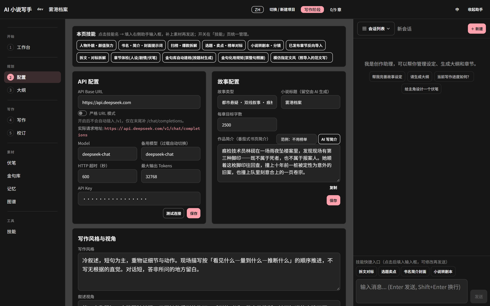
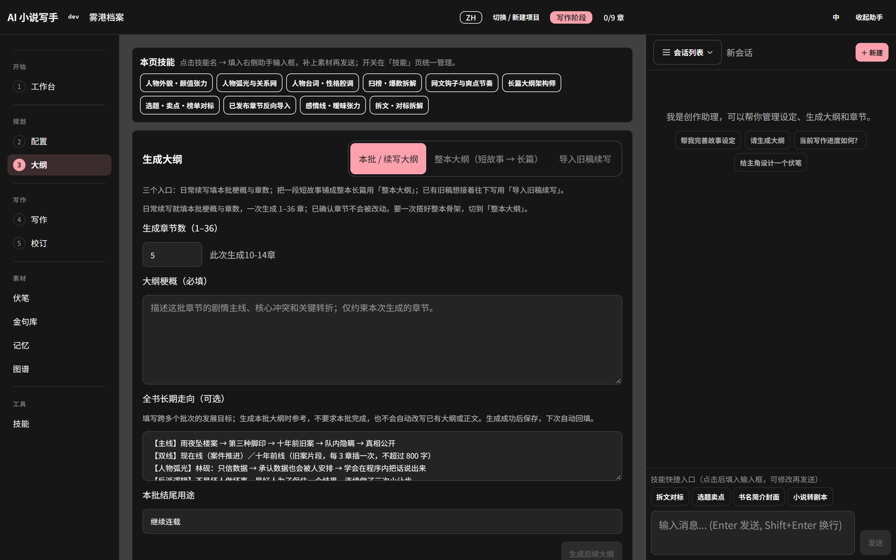
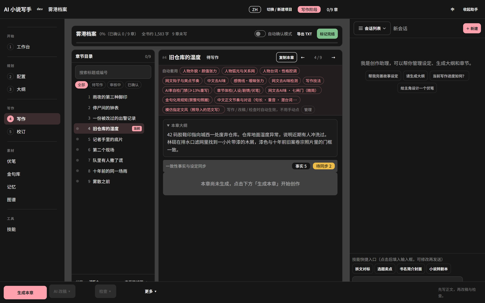
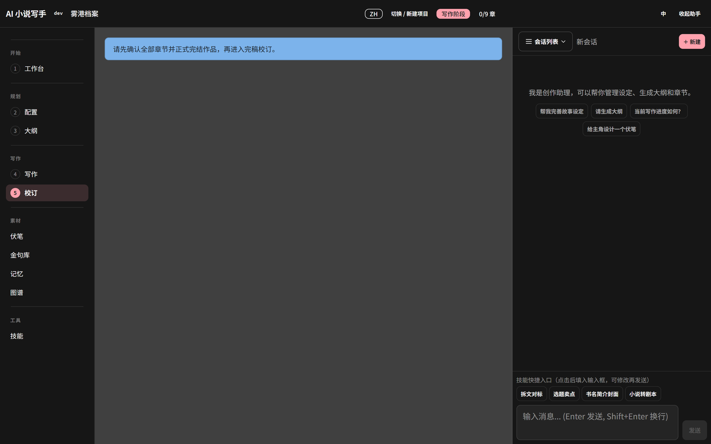
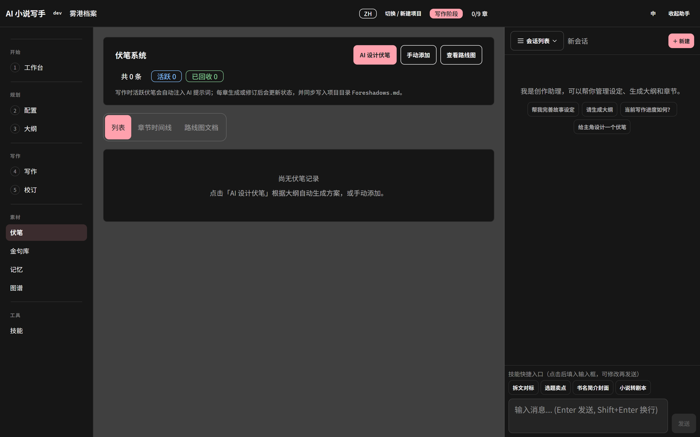
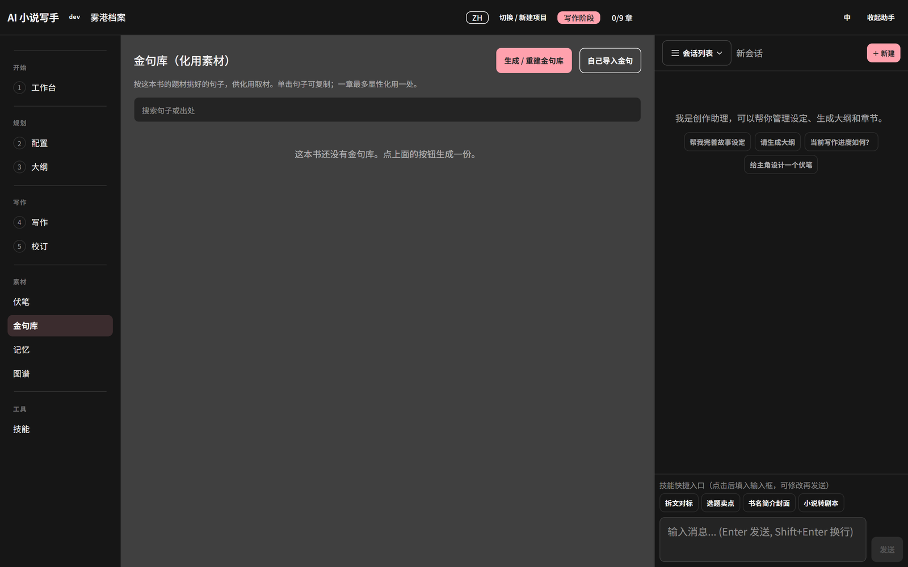
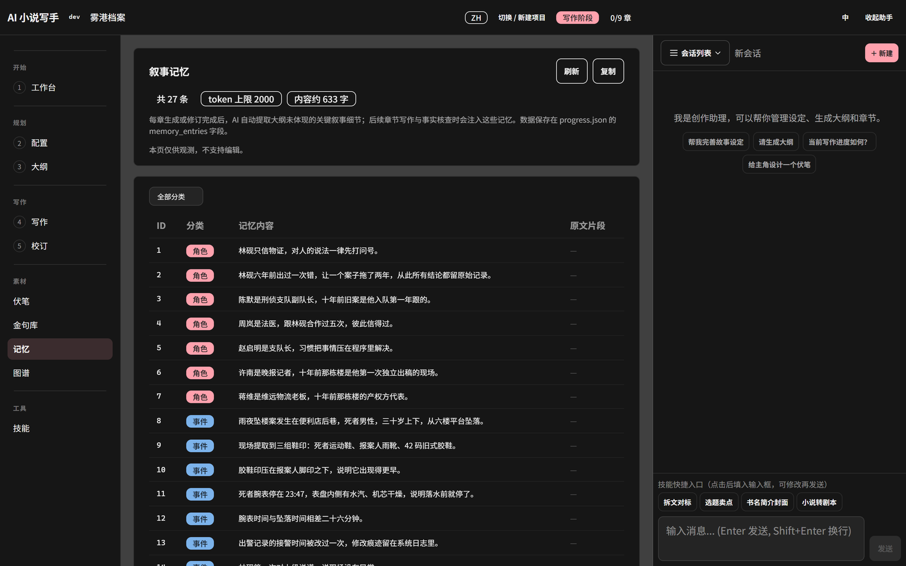
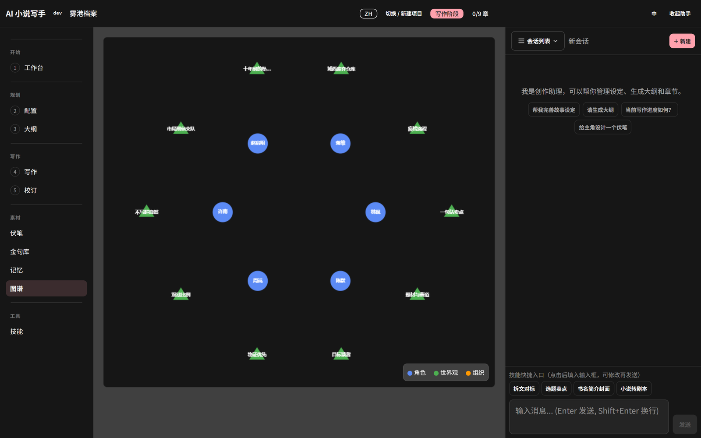
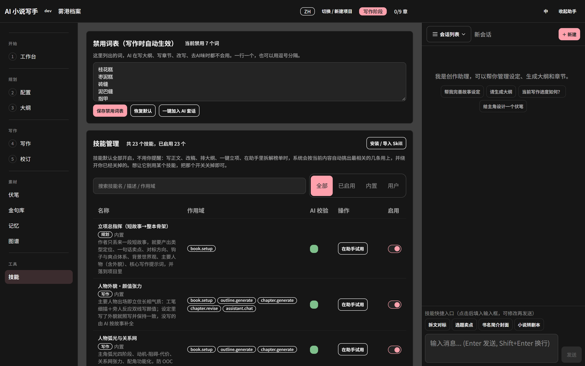

# Show Me The Story 使用手册

> 适用版本：本地打包版（Windows）
> 阅读顺序建议：第 1–2 章跑通第一次启动，第 3–6 章是日常写作的主路径，其余按需查。

---

## 目录

1. [安装与首次启动](#1-安装与首次启动)
2. [新建项目](#2-新建项目)
3. [工作台](#3-工作台)
4. [配置：设定与人物](#4-配置设定与人物)
5. [大纲：分批排纲](#5-大纲分批排纲)
6. [写作：逐章生成与审核](#6-写作逐章生成与审核)
7. [校订](#7-校订)
8. [伏笔](#8-伏笔)
9. [金句库](#9-金句库)
10. [记忆](#10-记忆)
11. [图谱](#11-图谱)
12. [技能](#12-技能)
13. [备份、导出与迁移](#13-备份导出与迁移)
14. [常见问题](#14-常见问题)
15. [安全与隐私](#15-安全与隐私)

---

## 1. 安装与首次启动

### 1.1 准备目录

新建一个空目录，把程序放进去。**这个目录同时就是数据目录**，小说、设定、备份都在里面，换电脑时整目录拷走即可。

```
ShowMeTheStory/
├── show-me-the-story.exe
├── config.example.json
└── api.json          ← 由示例复制而来
```

### 1.2 配置模型（唯一必须手动做的一步）

把 `config.example.json` 复制一份，改名为 `api.json`，然后用记事本打开：

```json
{
  "api_key": "请在这里填入你的 API Key",
  "base_url": "https://api.deepseek.com",
  "model": "deepseek-chat",
  "fallback_model": "deepseek-chat",
  "max_tokens": 32768,
  "http_timeout_seconds": 600,
  "context_budget_tokens": 300000
}
```

只改 `api_key` 这一行：把「请在这里填入你的 API Key」替换成你自己的 key，引号保留。

> 用的是其他 OpenAI 兼容服务时，同时改 `base_url` 和 `model` 即可。
> `api.json` 是本地文件，**不要提交到 Git、不要随目录发给别人**。

### 1.3 启动与停止

- 启动：双击 `show-me-the-story.exe`（或运行 `start.ps1`）
- 停止：运行 `stop.ps1`。**关掉浏览器不等于关服务。**
- 关闭窗口后服务仍在后台，这是正常的：它是个本地 Web 服务。

### 1.4 打开界面

浏览器访问 <http://localhost:48090>：


第一次打开会自动进入上次的项目；没有项目时显示上面的项目列表。

---

## 2. 新建项目

在项目列表点「新建项目」：

1. **项目名**：只影响本地目录名，随便起。
2. **小说生成语言**：中文 / English。**创建后不可更改**，想换语言只能新建项目。
3. 点「创建」。

如果你之前导出过 ZIP，可以用「从项目备份恢复」：选择一个 ZIP，填新项目名，点「恢复为新项目」。
原项目不会被覆盖，恢复出来的是副本。

> ZIP 上限 256 MiB，解压后 512 MiB，单文件 64 MiB。
> 备份里**不包含**全局 API 配置和用户技能，换机器后需要重新填 `api.json`。

---

## 3. 工作台

进入项目后默认是工作台：


三块信息：

- **进度**：`已确认 0 / 9 章`、`9 章待生成`，一眼看出卡在哪。
- **流程卡**：配置 → 大纲 → 写作，每张卡有「打开」按钮。
- **技能区**：点技能名会把提示词填进右侧助手输入框，补上素材再发送。

右上角「切换 / 新建项目」可以回到项目列表；「收起助手」可以隐藏右侧对话面板。

工作台顶部那句提示会随进度变化，比如「继续写第 1 章」「第 3 章已生成，去写作页审阅并确认」——**跟着它走就不会乱**。

---

## 4. 配置：设定与人物



### 4.1 故事设定

| 字段 | 怎么填 | 建议 |
|---|---|---|
| 故事类型 | 题材标签，越具体越好 | 例：`古言权谋 · 宅斗 · 兄妹亲情主轴` |
| 每章字数 | 500–20000 | 网文连载建议 2000–3000；番茄/七猫常见 2000–2500 |
| 写作风格 | 句长、视角、对白规则、禁止项 | 写得像「编辑给的要求」，不要写「文笔好一点」 |
| 叙述视角 | 第一人称 / 第三人称限知 / 全知 | 长篇建议第三人称限知，稳定 |

写作风格是最值钱的一栏。有效的写法是给**可执行的规则**，例如：

> 短句碎段，重动作、对白与心理。自然段一到三句，情绪最重的一句单独成段。
> 对白用中文双引号，一人一段，说话人的动作放在引号外。
> 写吃食、银子、药香、衣料褶子，不写空泛景物和套话。

### 4.2 人物卡

每个人物建议填：姓名、年龄、外貌、性格、背景、动机、能力边界、备注（说话方式）。

- **动机**决定他在冲突里怎么选；**能力边界**决定他不能做什么，这两栏最能防 OOC。
- **外貌**只需填你在意的几个人，其余留空由 AI 按故事补全并长期保持一致。
- 人物首次登场、换装换场时才会描写外貌，不必每章重复。

### 4.3 世界观条目

按「势力 / 规矩 / 场所 / 制度 / 旧案 / 禁忌」分类建条目，一条一句话讲清约束。

例：
- `规矩·义女代嫁`：义女可代嫡女出嫁，但需宗人府核籍。
- `禁忌·妖异福运之忌`：公开谈论福运者以妖言论处。

这些条目会喂给大纲和正文，**大纲不许另起一套地名机构**，正文照外貌与性格写。

### 4.4 一键立项

配置页底部有两个入口：

- **一键立项·只写设定**：扫榜简单拆解 → 人设与背景（写进配置）
- **一键立项·连大纲**：拆解 → 人设与背景 → 排整本大纲

适合「只有一句点子」的时候。已有明确设定时，跳过这步，直接手填更快。

---

## 5. 大纲：分批排纲



### 5.1 两种排法

| 方式 | 适用 | 说明 |
|---|---|---|
| 一次排整本大纲 | 短篇、已有完整构思 | 慢，容易撞模型输出上限，不推荐长篇 |
| **分批拆榜 → 分批排大纲** | 长篇连载 | 推荐。每次只处理 3–6 章，质量稳定 |

### 5.2 参数怎么填

- **全书总章节**：先填一个目标值（如 100），后面可以改。
- **本批章数**：1–36。**第一次建议 3–6 章**，跑通再放大。
- **重排变化度**：稳一点（不动主线）/ 换细节（换戏）/ 换一套（大改）。
- **展开方式**：忠于原故事 / 往后写（当引子）/ 换主视角 / 并一条新主线 / 换结构（倒叙、双线）。

### 5.3 扫榜（找对标）

榜单只是候选池，不用自己挑：主按钮会让 AI 按你的短故事从里面选对标。

1. 选榜单源：七猫 / 晋江
2. 选频道：女生 / 男生
3. 选榜单：新书榜 / 热销榜 / 收藏榜 / 完结榜 / 更新榜
4. 选周期：日榜 / 月榜
5. 点「拉取榜单」

### 5.4 对标正文

三种来源：

- **抓免费章**：爬虫只读公开榜单页与公开书籍页，抓不用登录就能读的前几章。
- **自己粘贴**：把正文粘进「对标书正文」框。
- **从本机载入**：之前抓过的会存在 `对标正文/` 目录，选一本点「载入」。

> 入 V 章节页面上没有正文，需要你自己从有权限的渠道复制。工具不绕过付费墙。

填好后点「用这段正文拆解」，按真正文拆开篇钩子与节奏，比只看榜单准得多。

### 5.5 审阅与确认

生成完不要直接开写，先逐条看：

- 这一批有没有推进主线？还是原地打转？
- 有没有提前透支后面的爆点？
- 新出现的人/地名，配置里有没有对应条目？
- 每章结尾有没有钩子？

改完再点确认。**未确认的大纲不会进入写作流程。**

---

## 6. 写作：逐章生成与审核



### 6.1 生成当前章

点「生成当前章」，然后等。一次会跑三件事：

1. 生成正文（目标字数按配置）
2. 生成章节摘要（供后续压缩上下文）
3. 跑一致性检查（事实、设定、伏笔）

长章节 + 大上下文时，一次可能要几分钟，`http_timeout_seconds` 建议不低于 600。

### 6.2 五个审核点

1. **章纲对齐**：本章该发生的事发生了吗？有没有跑题？
2. **人物 OOC**：说话方式、动机、能力边界对不对？
3. **时间线**：和上一章结尾接得上吗？有没有写回退？
4. **伏笔**：该埋的埋了吗？该收的收了吗？
5. **重复**：这个桥段/句式前面用过吗？

### 6.3 三种修改方式

| 方式 | 适用 |
|---|---|
| 章节修订 | 整章方向不对，给修改意见让 AI 重写 |
| 段落修订 | 只改某几段，保留其余 |
| 人工编辑 | 自己动手改，AI 不参与 |

修改可能影响后续章节的关键事实时，系统会列出**受影响的段落**让你核对，不会自动改别的章。

### 6.4 确认

满意后点「确认」。确认后这一章才会进入上下文，成为后续写作的依据。

不满意就继续改，**不要带着问题确认**——确认的章节会长期影响后面几十章。

### 6.5 去 AI 味

写作页和技能页都有「中文去 AI 味」。它的作用是去掉：排比堆砌、万能形容词、过度解释情绪、每段总结陈词。

配合「AI 率自检门禁（≥13% 重写）」使用：检测值超标就退回重写，不要手工糊。

---

## 7. 校订



校订页用来做**跨章检查**，不是改错别字：

- 全局事实是否一致（谁在哪、谁不知道什么）
- 设定是否被正文悄悄改掉
- 已确认章节之间有没有互相矛盾

发现冲突时，选择改正文还是改设定——**改设定会污染后面所有章节，优先改正文**。

---

## 8. 伏笔



伏笔分「规划」和「已埋」两套状态跟踪：

- 规划：大纲阶段就想埋的
- 已埋：正文里实际写出来的（可能和大纲有偏差）
- 已回收：后面章节兑现了

完结前必须过一遍：**未回收伏笔会继续影响后续章节**，也是烂尾的主要原因。

---

## 9. 金句库



按题材自动建档，写作时化用。规则是**禁止整句照搬**，只借句式和节奏。

用法：
1. 「金句库自动建档」按题材生成一批
2. 写作时在助手面板引用
3. 「金句化用规矩」约束改写幅度

---

## 10. 记忆



记忆页是这本书的「设定数据库」：

- 人物、组织、世界观、关系
- 从正文抽取的关键事实（带出处章节）
- 待确认的设定变化

**事实与设定冲突时，系统会拦下来让你确认**，不会静默覆盖。
「待同步」表示正文改了但设定还没跟上，记得处理。

---

## 11. 图谱



实体关系图，用来查「谁和谁是什么关系」「这个势力出现过几次」。

写群像戏、宅斗、多男主时特别有用：人物一多，最容易写串的是称谓和立场。

---

## 12. 技能



技能不是提示词收藏夹，而是**挂在写作流程上的规则**：每个技能用 `skill.json` 声明自己在哪一步生效
（生成正文、修订、润色、事实核查、助手对话），用 `SKILL.md` 写具体判定标准和动作。

### 12.1 本项目已安装的 7 个技能

| 技能 | 它到底做什么 | 生效阶段 | 状态 |
|---|---|---|---|
| **AI 率自检门禁（≥13% 重写）** | 按黑名单词密度、句式重复、段落均匀度、总结升华句、排比句等 6 项统计，给出 AI 率；≥13% 判不通过并触发重写 | 生成 / 修订 / 润色 / 事实核查 | 已启用 |
| **章节体检（人设/剧情/伏笔）** | 扫 7 类问题：人设口吻、行为动机、人物状态链、剧情断层、伏笔台账、时间器物、视角纪律；产出 Markdown 报告，**报告不进正文** | 事实核查 / 修订 / 助手 | 已启用 |
| **金句库自动建档（按题材生成）** | 按题材、时代、地域生成 60–90 条公有领域金句（每条带出处），写入世界观 `knowledge` 条目 | 助手 | 已启用 |
| **金句化用规矩（禁整句照搬）** | 规定哪些场合可整句引用（牌匾、对联、题字等实物），其余必须改字换序；控制一章的化用密度 | 生成 / 修订 / 润色 / 助手 | 已启用 |
| **模仿指定文风（照导入的范文写）** | 动笔前先把范文量成六条参数：句长、段长、人称距离、口吻、情绪落点、时间场景，再照这六条写 | 生成 / 修订 / 润色 / 助手 | 已启用 |
| **网文去 AI 味 · 七闸门（精简）** | 先定档（轻度/中度/重度），再逐项清除 AI 腔；改味不改剧情，带删除保护与删除上限 | 润色 / 修订 | 已安装，未注册 |
| **中文正文节奏与对话** | 把句长呼吸、句末重音、中文顺口度、对话潜台词、场景结构与结尾收束写成可执行条目 | 生成 / 修订 | 已安装，未注册 |

> 「已启用」= 出现在 `skills/.registry.json` 里。未注册的技能文件仍在，但不会自动参与生成。

### 12.2 怎么用

绝大多数技能是**自动生效**的：写作页点「生成当前章」时，系统按 `applies_to` 把对应技能拼进提示词，你不需要手动调用。

手动调用用于两种情况：

1. 想在助手面板里单独跑一次（比如「章节体检」）
2. 想临时加一条规则（比如「模仿指定文风」）

做法：技能页点技能名 → 提示词填入右侧助手输入框 → 补上素材（章节号、范文）→ 发送。

### 12.3 自己加一个技能

在 `skills/` 下新建目录，放两个文件：

```json
// skills/my-skill/skill.json
{
  "schema_version": 1,
  "id": "my-skill",
  "name": "技能显示名",
  "description": "一句话说明它做什么",
  "category": "writing",
  "languages": ["zh"],
  "applies_to": ["chapter.generate", "chapter.revise"],
  "entrypoint": "SKILL.md"
}
```

`SKILL.md` 写可执行规则：判定标准、禁止项、输出格式。写完后在技能页启用（注册后才会自动参与生成）。

`applies_to` 可选值：`chapter.generate`、`chapter.revise`、`chapter.polish`、`chapter.fact_check`、`assistant.chat`。

### 12.4 应用自带技能库

除了上面 7 个，应用还带一个技能库（扫榜·爆款拆解、拆文·对标拆解、长篇大纲架构师、书名·简介·封面提示词、小说转剧本·分镜等）。
这些是「按需调用」的工具，不影响默认写作流程；在技能页或工作台底部点一下就会把提示词填进助手。

---

## 13. 备份、导出与迁移

- **导出**：全书完成后可导出 TXT。
- **备份 ZIP**：项目列表里每本书都有「备份 ZIP」，导出整本（正文、设定、会话、校订状态）。
- **恢复**：项目列表「从项目备份恢复」→ 选 ZIP → 填新项目名 → 恢复为新项目。
- **整机迁移**：先 `stop.ps1` 关服务，再复制整个目录。新机器上重新填 `api.json`。

建议节奏：每完成一批（3–6 章）备份一次，别等全书写完。

---

## 14. 常见问题

**Q1：启动后浏览器打不开 localhost:48090？**
先确认进程在跑（任务管理器找 `show-me-the-story.exe`），再看端口是否被占用：
`Get-NetTCPConnection -LocalPort 48090 -State Listen`。

**Q2：生成到一半失败 / 超时？**
把 `http_timeout_seconds` 调到 900，`max_tokens` 保持 32768；一次生成的章节数不要太大。

**Q3：提示模型不存在？**
`model` 要填服务商真实支持的模型名。换服务商时 `base_url` 和 `model` 要一起改。

**Q4：大纲总是跑偏？**
先补世界观条目和人物动机，再重排。设定越具体，大纲越不容易另起一套。

**Q5：正文有 AI 味？**
先跑「中文去 AI 味」，再过「AI 率自检门禁」；还不行就改写作风格里的句长与对白规则。

**Q6：人物写着写着变了？**
检查记忆页的「待同步」和「待确认设定变化」，把冲突处理掉再继续。

**Q7：能导入已经发布的书吗？**
用「已发布章节反向导入」技能，或在大纲页「导入章节」，把旧稿接进来续写。

**Q8：能多人同时用吗？**
不建议。数据是本机文件，没有并发控制。

**Q9：数据存在哪？**
程序目录下的 `storys/<项目名>/`。备份就是把这个目录打包。

**Q10：换电脑怎么迁？**
`stop.ps1` → 复制整个目录 → 新机器填 `api.json` → 启动。

---

## 15. 安全与隐私

1. `api.json` 是**明文密钥**。不要提交 Git，不要打包外发。
2. 程序默认监听所有网卡且无鉴权，同一 Wi-Fi 的设备可以访问你的书稿和配置接口。
   只想自己用时，以管理员身份运行 `仅本机访问-需管理员运行.ps1`。
3. 所有正文与设定都在本机，只有调用模型时会把上下文发给服务商，注意隐私内容。
4. 定期备份。ZIP 里包含正文与设定，妥善保管。

---

*本手册基于实际界面编写，截图取自示例项目「雾港档案」，不含真实书稿内容。*
